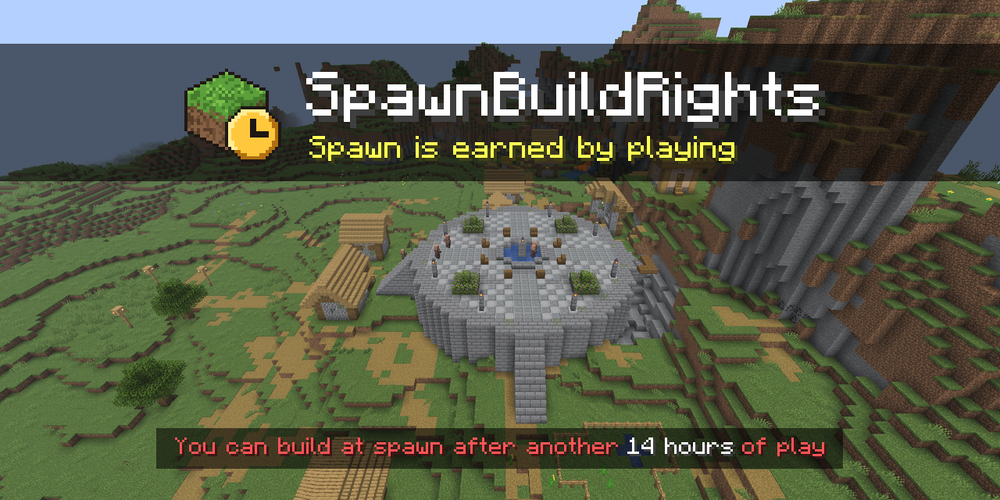

<p align="center">
  <a href="LICENSE"></a>
  <a href="https://github.com/lewisgibson/spawn-build-rights/releases/latest"></a>
  
  
</p>

SpawnBuildRights builds on vanilla spawn protection. Vanilla stops everyone except operators building near spawn. With SpawnBuildRights everyone can use spawn from their first minute, and each player can build there once they have played for as long as you choose. The build is also protected from explosions, mobs, fire and anything that reaches in from outside, whoever is behind it.

This is an unofficial, community plugin. It is not affiliated with, authorised by, or endorsed by PaperMC, Mojang or Microsoft.

## Requirements

Paper, Purpur or Folia 26.3, and Java 25. On Folia every protection works except portal arrivals, as [compatibility](docs/compatibility.md) explains.

## Install

1. Download `SpawnBuildRights-<version>.jar` from the [latest release](https://github.com/lewisgibson/spawn-build-rights/releases/latest) or [Modrinth](https://modrinth.com/plugin/spawnbuildrights).
2. Put it in your server's `plugins` folder.
3. Set `spawn-protection=0` in `server.properties`, then restart the server.

Vanilla spawn protection is applied before any plugin, so while it is on it also stops players who have earned build rights. SpawnBuildRights warns in the console and tells operators when they join until it is off.

## Build rights


A player who tries to build at spawn too early is told how much longer they need to play, and `/sbr` tells them the same. Playtime is the game's own statistic, so time played before you install the plugin counts.

| At spawn, a player can                                 | New player | After the required playtime | Granted | Revoked |
| ------------------------------------------------------ | :--------: | :-------------------------: | :-----: | :-----: |
| Walk, fight, trade, ride and sleep                     |     ✅     |             ✅              |   ✅    |   ✅    |
| Open doors and gates, press buttons, pull levers       |     ✅     |             ✅              |   ✅    |   ✅    |
| Use chests, furnaces, crafting tables and workstations |     ✅     |             ✅              |   ✅    |   ✅    |
| Break and place blocks, edit signs                     |            |             ✅              |   ✅    |         |
| Use buckets, start fires, plant and use bone meal      |            |             ✅              |   ✅    |         |
| Place and change item frames, paintings, armour stands |            |             ✅              |   ✅    |         |

[How it works](docs/how-it-works.md) lists every action that needs build rights.

## Protections

Inside the region SpawnBuildRights stops everything below, whoever is behind it. Each protection has a switch under `protection:` in `config.yml`, and every one is on by default.

| Stops                                                                                           | Switch                |
| ----------------------------------------------------------------------------------------------- | --------------------- |
| Creepers blowing up blocks                                                                      | `explosions`          |
| TNT and TNT minecarts blowing up blocks                                                         | `explosions`          |
| End crystals blowing up blocks                                                                  | `explosions`          |
| Beds and respawn anchors exploding in the wrong dimension                                       | `explosions`          |
| The wither and its skulls blowing up blocks                                                     | `explosions`          |
| Ghast fireballs blowing up blocks                                                               | `explosions`          |
| Explosions lighting fires                                                                       | `explosions`          |
| An explosion outside setting off TNT inside                                                     | `explosions`          |
| Endermen picking up or placing blocks                                                           | `hostile-mob-changes` |
| Zombies and vindicators breaking doors                                                          | `hostile-mob-changes` |
| Silverfish hiding in stone or bursting out of it                                                | `hostile-mob-changes` |
| The wither and the ender dragon breaking blocks they touch                                      | `hostile-mob-changes` |
| Hostile mobs trampling farmland or turtle eggs                                                  | `hostile-mob-changes` |
| Hostile mobs' arrows breaking decorated pots, chorus flowers or pointed dripstone               | `hostile-mob-changes` |
| Blaze and ghast fireballs lighting fires                                                        | `hostile-mob-changes` |
| Flaming arrows lighting fires or setting off TNT, a player's included                           | `hostile-mob-changes` |
| Item frames, paintings and armour stands broken by mobs                                         | `display-damage`      |
| Item frames, paintings and armour stands broken by explosions and fireworks                     | `display-damage`      |
| Item frames, paintings and armour stands broken by fire, lava or lightning                      | `display-damage`      |
| Item frames, paintings and armour stands broken by arrows or potions with no player behind them | `display-damage`      |
| Item frames, paintings and armour stands broken by falling anvils or dripstone                  | `display-damage`      |
| Blocks burning away                                                                             | `fire-damage`         |
| Fire spreading in                                                                               | `fire-damage`         |
| Lava lighting fires                                                                             | `fire-damage`         |
| Lightning lighting fires                                                                        | `fire-damage`         |
| Fire setting off TNT                                                                            | `fire-damage`         |
| Sand, gravel, concrete powder, anvils and other falling blocks from outside landing inside      | `falling-blocks`      |
| Water flowing in from outside                                                                   | `fluid-flow`          |
| Lava flowing in from outside                                                                    | `fluid-flow`          |
| A dragon egg teleporting in from outside                                                        | `fluid-flow`          |
| Pistons outside pushing blocks in or extending into the region                                  | `pistons`             |
| Pistons outside moving or breaking blocks inside                                                | `pistons`             |
| Sticky pistons outside pulling blocks out                                                       | `pistons`             |
| Dispensers outside pouring water in                                                             | `dispensers`          |
| Dispensers outside pouring lava in                                                              | `dispensers`          |
| Dispensers outside placing fire, TNT, blocks or bone meal inside                                | `dispensers`          |
| Arrows, fire charges, snowballs, eggs, potions and fireworks fired in by dispensers outside     | `dispensers`          |
| Trees and huge mushrooms grown outside spreading in                                             | `growth`              |
| Bone meal used outside spreading grass and flowers in                                           | `growth`              |
| TNT and TNT minecarts arriving through a portal                                                 | `portal-arrivals`     |
| Wither skulls arriving through a portal                                                         | `portal-arrivals`     |
| Ghast, blaze and dragon fireballs arriving through a portal                                     | `portal-arrivals`     |
| Arrows, tridents, llama spit, shulker bullets and harmful potions arriving through a portal     | `portal-arrivals`     |
| Firework rockets with stars arriving through a portal                                           | `portal-arrivals`     |
| Sand and other falling blocks arriving through a portal                                         | `portal-arrivals`     |
| Water or lava poured from a bucket by a player without build rights                             | Build rights          |
| Fire or TNT lit by a player without build rights                                                | Build rights          |


[Protections](docs/protections.md) has a before and after picture for each switch.

## Settings

The settings are in `plugins/SpawnBuildRights/config.yml`, and `/sbr reload` applies them. Some you may want to change:

| Setting                 | What it does                                                       |
| ----------------------- | ------------------------------------------------------------------ |
| `region.radius`         | How far the region reaches from its centre, in blocks              |
| `region.shape`          | `square`, the same shape as vanilla spawn protection, or `circle`  |
| `required-playtime`     | How long a player must play before they can build, such as `12h`   |
| `messages.build-denied` | What a player is told when they try to build too early             |
| `storage.type`          | Where grants and revocations are kept: SQLite, PostgreSQL or MySQL |

[Configuration](docs/configuration.md) explains every setting.

## Commands

Players with `spawnbuildrights.info` can run `/sbr` to see where they stand. Admins, with `spawnbuildrights.admin`, can grant or revoke build rights, read a player's history, change the region and reload the settings:

```
/sbr grant Steve built the spawn shop
/sbr revoke Griefer123 broke the fountain
/sbr history Steve
/sbr set radius 24
/sbr reload
```

[Commands and permissions](docs/commands.md) lists them all, with LuckPerms examples.

## Documentation

- [How it works](docs/how-it-works.md)
- [Protections](docs/protections.md)
- [Configuration](docs/configuration.md)
- [Commands and permissions](docs/commands.md)
- [Storage](docs/storage.md)
- [Deployment](docs/deployment.md)
- [Compatibility](docs/compatibility.md)
- [Troubleshooting](docs/troubleshooting.md)
- [FAQ](docs/faq.md)

## Contributing

Contributions are welcome. [CONTRIBUTING.md](CONTRIBUTING.md) explains how to build and test the plugin, and [architecture](docs/architecture.md) describes the code.

## Acknowledgements

- [Paper](https://papermc.io/) is the server the plugin is built for (GPL-3.0).
- Paper downloads [HikariCP](https://github.com/brettwooldridge/HikariCP) (Apache-2.0), the [PostgreSQL driver](https://github.com/pgjdbc/pgjdbc) (BSD-2-Clause) and the [MariaDB driver](https://github.com/mariadb-corporation/mariadb-connector-j) (LGPL-2.1) for the plugin when it first loads.
- [MockBukkit](https://github.com/MockBukkit/MockBukkit) runs the integration tests, and [itzg/minecraft-server](https://github.com/itzg/docker-minecraft-server) the server tests.

## License

GPL-3.0, see [LICENSE](LICENSE). The jar contains only the plugin's own code; see [THIRD-PARTY-NOTICES.txt](THIRD-PARTY-NOTICES.txt).
