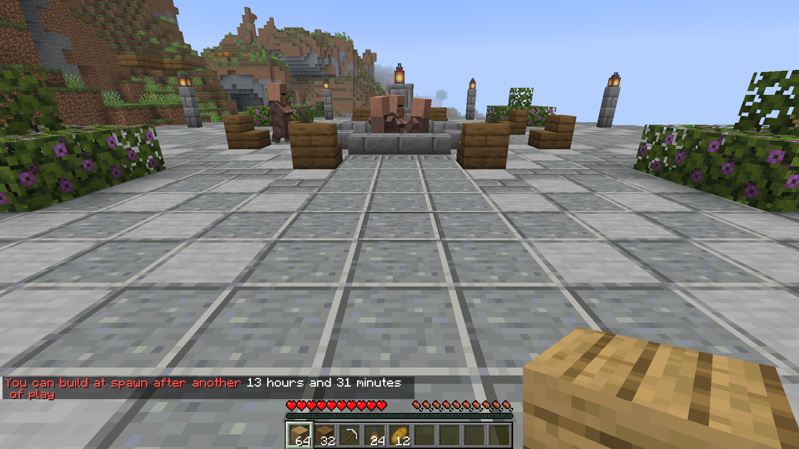

# Commands and permissions

Use `/sbr` or `/spawnbuildrights` for the same commands. Every command works in game and from the server console except `/sbr set center here`, which needs a player's location.

| Command                        | What it does                                                            | Permission               |
| ------------------------------ | ----------------------------------------------------------------------- | ------------------------ |
| [`/sbr info`](#sbr-info)       | Tell a player whether they can build at spawn, or show admins the setup | `spawnbuildrights.info`  |
| [`/sbr grant`](#sbr-grant)     | Grant access without waiting for playtime                               | `spawnbuildrights.admin` |
| [`/sbr revoke`](#sbr-revoke)   | Block building regardless of playtime                                   | `spawnbuildrights.admin` |
| [`/sbr reset`](#sbr-reset)     | Remove a saved grant or revocation                                      | `spawnbuildrights.admin` |
| [`/sbr history`](#sbr-history) | Show a player's saved decision and recent history                       | `spawnbuildrights.admin` |
| [`/sbr set`](#sbr-set)         | Change and save the playtime requirement, radius, shape or centre       | `spawnbuildrights.admin` |
| [`/sbr reload`](#sbr-reload)   | Apply changes from `config.yml` and reload saved build-rights decisions | `spawnbuildrights.admin` |

Where a command takes `<player>`, you can use an online player's name, an offline name still in the server's player cache, or a UUID. Names are never looked up with Mojang, so this works offline and on networks. A name known only to another server may need a UUID here.

## `/sbr info`

`/sbr` on its own does the same as `/sbr info`. A player gets one sentence about their own build rights, the same one the action bar shows when a change at spawn is refused:



| Where the player stands        | What they are told                                                  |
| ------------------------------ | ------------------------------------------------------------------- |
| Still earning build rights     | You can build at spawn after another 9 hours and 46 minutes of play |
| Played long enough, or granted | You can build at spawn                                              |
| Revoked                        | Your permission to build at spawn has been removed                  |

The three sentences are `build-denied`, `build-allowed` and `build-revoked` under `messages:` in `config.yml`.

Admins and the console get the detail instead: the version, the region, the requirement and which [protections](protections.md) are on. An admin running it in game also sees their own playtime, any saved decision and whether a `spawnbuildrights.build` value applies to them.

```
SpawnBuildRights 1.0.0+mc26.3
Spawn region: square, 16 blocks around 0, 0 in world
Build rights after: 12h of playtime
Protections on: explosions, hostile-mob-changes, display-damage, fire-damage, falling-blocks, fluid-flow, pistons, dispensers, growth
Protections off: none
Portal arrivals defused: explosives, wither-skulls, fireballs, projectiles, fireworks, falling-blocks
Portal arrivals passed: none
Your playtime: 2h 14m (9h 46m to go)
Manual decision: none
You can build at spawn: no
```

## `/sbr grant`

```
/sbr grant <player> [reason]
```

Grant a player access now, whatever their playtime. The grant replaces any saved revocation and stays until you replace it or use `/sbr reset`.

You can include a reason for the history, with reasons longer than 255 characters cut to 255.

```
> /sbr grant Steve built the spawn shop for us
Steve can build at spawn now, whatever their playtime.
```

An explicit `false` on the build permission still blocks access, even after this success message.

## `/sbr revoke`

```
/sbr revoke <player> [reason]
```

Stop a player building at spawn, however long they play. The revocation replaces any saved grant and applies to their next attempt without them needing to leave and rejoin.

As with a grant, the reason is optional and saved in the history.

```
> /sbr revoke Griefer123 broke the fountain
Griefer123 cannot build at spawn until /sbr reset, however long they play.
```

The player sees `build-revoked` when they try to change the region. You can remove the revocation with `/sbr reset` or replace it with `/sbr grant`, though an explicit permission denial still applies.

## `/sbr reset`

```
/sbr reset <player>
```

Remove a saved grant or revocation so the build permission decides, or playtime if no permission applies.

```
> /sbr reset Steve
Steve is back to playtime deciding.
> /sbr reset Alex
Alex: had no override to remove.
```

This command leaves permissions in your permissions plugin unchanged. If there is no saved decision to remove, it adds no history entry.

## `/sbr history`

```
/sbr history <player>
```

Show the player's current saved decision and their last ten events. Events appear newest first with times in UTC, and entries made in the same moment keep their order.

```
> /sbr history Steve
Steve override: granted by Admin at 2026-10-11 14:02 UTC (built the spawn shop for us)
2026-10-11 14:02 UTC: granted by Admin (built the spawn shop for us)
2026-10-04 19:40 UTC: revoked by console (testing)
2026-09-30 18:12 UTC: earned by playtime at 36h 4m
```

The `earned` entry is recorded once when playtime first allows access. This can happen when the player joins or first tries a protected action after reaching the requirement during a session. A grant or revocation takes precedence, so having enough playtime alone does not create this entry while either applies.

## `/sbr set`

Change a setting immediately and save it in `config.yml`. The file's comments are kept and the setting survives a restart.

| Command                           | Example                 | Answer                                |
| --------------------------------- | ----------------------- | ------------------------------------- |
| `/sbr set threshold <duration>`   | `/sbr set threshold 2d` | `Required playtime set to 48h.`       |
| `/sbr set radius <blocks>`        | `/sbr set radius 24`    | `Radius set to 24.`                   |
| `/sbr set shape <square\|circle>` | `/sbr set shape circle` | `Shape set to circle.`                |
| `/sbr set center here`            | `/sbr set center here`  | `Region centre set to your location.` |

A duration can include spaces, so `/sbr set threshold 1d 12h` sets a requirement of 36 hours.

`center here` uses your current block's X and Z coordinates, and you must stand in the region's world. The command fixes the centre at that location so it no longer follows the world spawn.

The radius must be a whole number, 0 or more.

## `/sbr reload`

Read `config.yml` and saved build-rights decisions again, then apply them immediately. For example, if another server sharing your PostgreSQL or MySQL database grants a player access, `/sbr reload` brings that grant into effect here.

```
> /sbr reload
Configuration reloaded.
```

If a value is invalid, the reply names the problem and the plugin keeps using its previous settings.

```
> /sbr reload
Reload failed: protection.explosions must be true or false, was 'flase'
```

## Permissions

| Permission               | Default | What it allows                                                                                                                             |
| ------------------------ | ------- | ------------------------------------------------------------------------------------------------------------------------------------------ |
| `spawnbuildrights.build` | op      | `true` grants access unless `/sbr revoke` applies. Explicit `false` blocks access. If unset, a saved decision applies first, then playtime |
| `spawnbuildrights.info`  | op      | Allows `/sbr info`. Without it, `/sbr` is hidden from tab completion and refused                                                           |
| `spawnbuildrights.admin` | op      | Allows every other command and includes `spawnbuildrights.info`                                                                            |

You do not need a permissions plugin, as server operators have all three permissions by default. Use `/sbr grant` and `/sbr revoke` to decide access for individual players.

You can change the build node's name with `build-permission` in `config.yml`, where it defaults to `spawnbuildrights.build`.

### With LuckPerms

```
# Let everyone check their own progress with /sbr info
/lp group default permission set spawnbuildrights.info true

# Trusted builders can build at spawn from day one
/lp group builder permission set spawnbuildrights.build true

# Moderators can manage build rights without being operators
/lp group moderator permission set spawnbuildrights.admin true

# Keep one player off the spawn build for good
/lp user Griefer123 permission set spawnbuildrights.build false

# Stop a server operator building, regardless of playtime
/lp user <name> permission set spawnbuildrights.build false
```

An explicit `false` blocks access even after a player reaches the playtime requirement, so it does not make a server operator earn access through playtime.

A permission denial and `/sbr revoke` each beat a grant from the other source. A new `/sbr grant` or `/sbr revoke` replaces the previous decision saved by `/sbr`.
