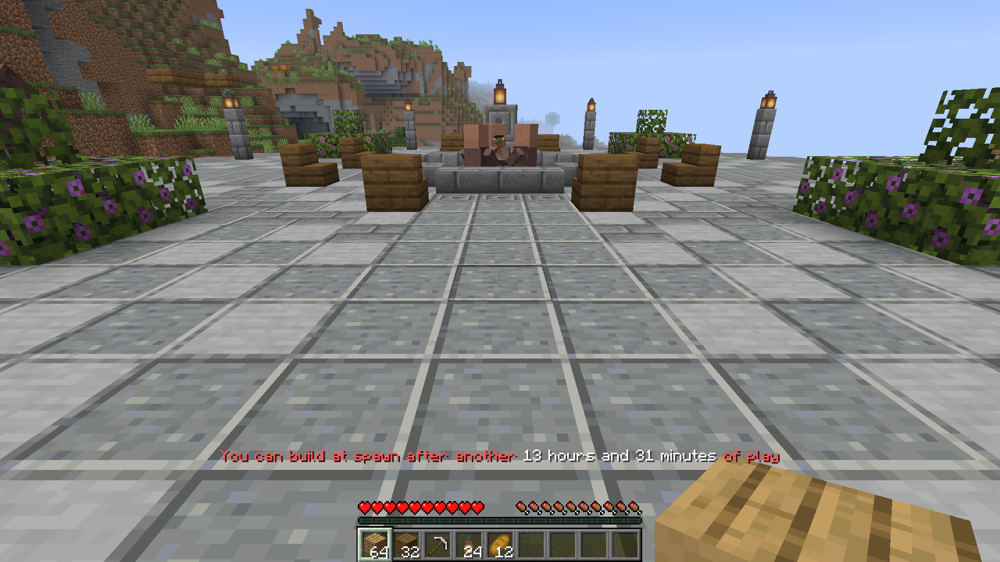
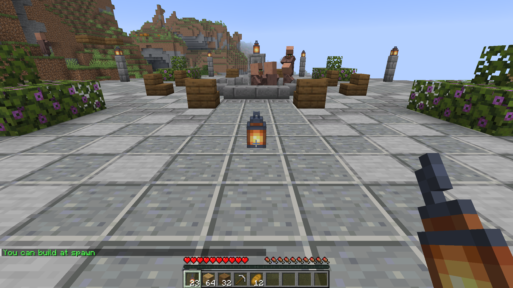
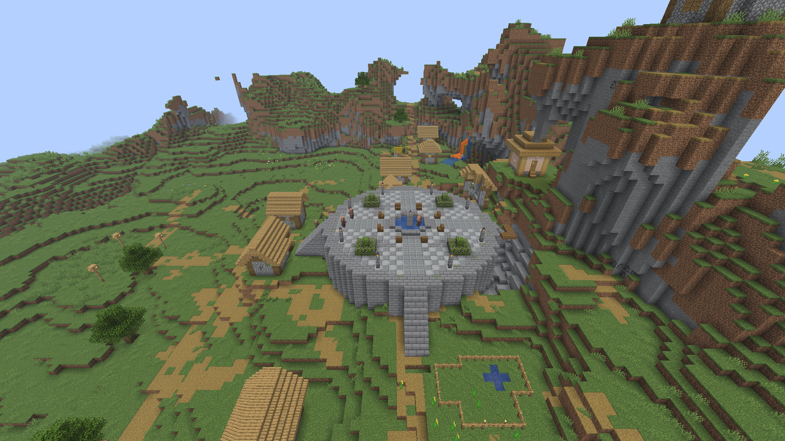

# How it works

## Who can build at spawn

SpawnBuildRights protects one square or circular region around your spawn. Each time a player tries to change it, the first rule that applies decides whether they can build.

1. A revocation blocks building if you set `spawnbuildrights.build` to `false` or use `/sbr revoke`, however long the player has played.
2. A grant allows building immediately if `spawnbuildrights.build` is `true` or you use `/sbr grant`, whatever the player's playtime. Server operators have this permission by default.
3. Otherwise, players can build once they have played for the time set in `required-playtime`.

For most players, you do not need to set anything because they earn access by playing.

### Examples

For example, with `required-playtime: 12h`:

| Player | Playtime | Permission node     | `/sbr` decision | Can build at spawn? | Why                                             |
| ------ | -------- | ------------------- | --------------- | :-----------------: | ----------------------------------------------- |
| Alex   | 2h 14m   | unset               | none            |         no          | 9h 46m still to play                            |
| Sam    | 41h 23m  | unset               | none            |         yes         | Enough playtime                                 |
| Jo     | 5h       | unset               | granted         |         yes         | Granted access by command                       |
| Kai    | 300h     | unset               | revoked         |         no          | A revocation beats playtime                     |
| Riley  | 1h       | `true`              | none            |         yes         | The permission grants access                    |
| Max    | 80h      | `true`              | revoked         |         no          | A revocation beats a grant                      |
| Robin  | 80h      | `false`             | granted         |         no          | The permission revokes access                   |
| An op  | 0h       | `true` (op default) | none            |         yes         | Server operators have the permission by default |

`/sbr reset <player>` removes the decision saved by `/sbr`, so the permission then decides, or playtime if no permission applies. Unsetting the node in your permissions plugin removes that explicit permission value, though server operators still receive the default grant.

## Where the playtime comes from

The plugin reads the game's own `minecraft:play_time` statistic. This is the "Time Played" total on a player's Statistics screen, kept by the server in `world/players/stats/<uuid>.json`.

Time played before you installed the plugin counts, so a regular who has already played long enough can build on the day you install it, unless you have revoked their access. Access takes effect on the next attempt after reaching the requirement, without leaving and rejoining or running a command.

The plugin does not keep a separate playtime total, so there is no second clock to drift out of step with the game and no playtime to migrate.

Time spent logged in includes idle time. If another plugin kicks an idle player, their time stops counting while they are disconnected.

## What counts as building

Inside the region, players need build rights to:

- break or place blocks, including crops, flowers and snow layers
- edit, dye, glow, dim or wax signs
- empty or fill buckets, including water, lava, powder snow and fish buckets
- start a fire with flint and steel or a fire charge
- place or break item frames, paintings and armour stands
- place boats, minecarts and end crystals
- change what is in an item frame or on an armour stand
- trample farmland
- eat a cake or put a candle on it
- put an eye of ender in a portal frame
- brush suspicious sand or gravel
- plant in or empty a flower pot
- carve a pumpkin with shears
- use bone meal on a block, such as spreading moss over nearby stone
- break a decorated pot, chorus flower or pointed dripstone with their own arrow or trident

Players can use spawn from their first minute without build rights for:

- doors, trapdoors, fence gates, buttons, levers and pressure plates
- chests, barrels, shulker boxes and furnaces
- crafting tables, anvils, enchanting tables, lecterns and other workstations
- beds and respawn anchors for sleeping or setting a spawn point
- bells, note blocks and jukeboxes
- villagers, trading, animals, riding and leads
- touching redstone ore or tilting a big dripleaf
- using a composter, picking glow berries or taking honeycomb from a hive

When an attempt is refused, the change does not happen, so a block stays in place or a bucket stays full. The player is told on the action bar above their hotbar how much longer they need to play, in one sentence, and `/sbr` tells them the same. You can change the wording in `config.yml`.

A player whose access is revoked by a command or permission sees `build-revoked` instead. Players with build rights can build without a message, and `/sbr` tells them they can build at spawn.

## The region

You protect one region in one world. By default, its centre follows the world spawn and moves immediately when you use `/setworldspawn`, or you can choose fixed coordinates in [configuration.md](configuration.md#regioncenter-x-and-regioncenter-z).

Choose a square or a circle, with `radius` extending that many blocks from the centre in each horizontal direction. A square with radius 16 covers 33 x 33 blocks, matching vanilla `spawn-protection=16`.

The default height runs from `min-y` -64 to `max-y` 320 with both bounds included, and you can choose a smaller slice of the height.

Use `/sbr set` to change the radius, shape or centre live ([commands.md](commands.md#sbr-set)). To change the world or height limits, edit `config.yml` and run `/sbr reload`.

The pictured plaza uses `shape: circle` and `radius: 14` to cover the stone circle.

## Keeping the region safe from everything else

Ten protections guard the build against damage beyond direct player edits. Explosions, hostile mobs and fire cannot destroy protected blocks, and displays are protected from environmental damage. Boundary protections stop falling sand, flowing water and lava, pistons, dispensers and growing trees reaching in from outside. Portal protection defuses dangerous arrivals before they reach spawn.

Every protection is on by default and has its own switch. [protections.md](protections.md) explains what each one stops and what still works, with before-and-after examples.

## What is stored

The plugin saves grants and revocations made with `/sbr`, along with who made each decision, the reason and the time. It also records a `/sbr reset` when that command removes a saved decision.

When a player is first seen earning access through playtime, the plugin records that once and includes their playtime at that moment.

You can read these records with `/sbr history`. They are kept in one SQLite file in the plugin's folder, or in PostgreSQL, MySQL or MariaDB ([storage.md](storage.md)). Build decisions are loaded into memory at startup and on reload, so a block event never waits for the database.

## Vanilla spawn protection

Minecraft's `spawn-protection` setting in `server.properties` blocks everyone except server operators from building near spawn. The server applies it before plugins, so it can still block players who have earned build rights.

By default, SpawnBuildRights warns in the console at startup and privately warns server operators and admins when they join. Set `spawn-protection=0` and restart so earned builders can use their rights ([deployment.md](deployment.md#vanilla-spawn-protection)).
