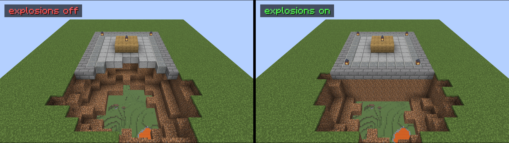
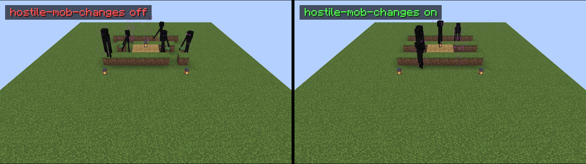
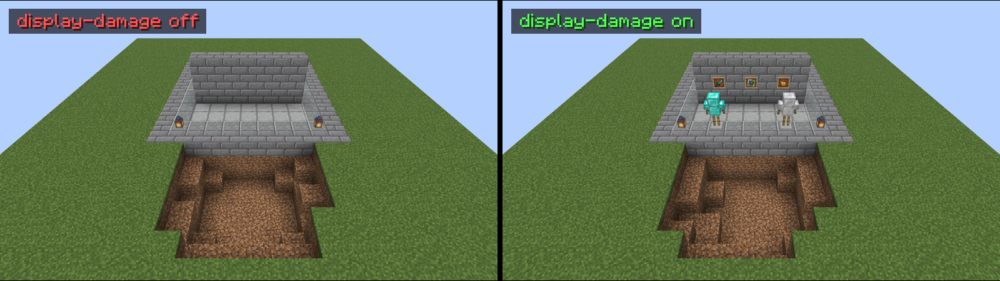
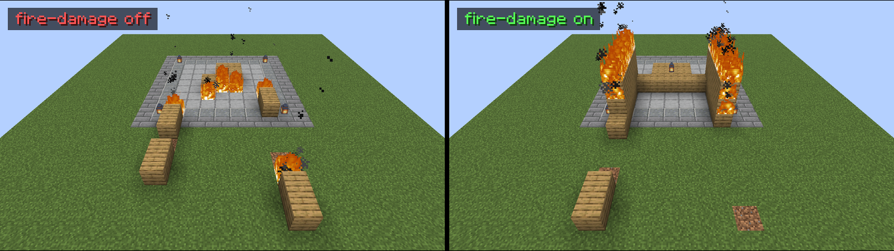
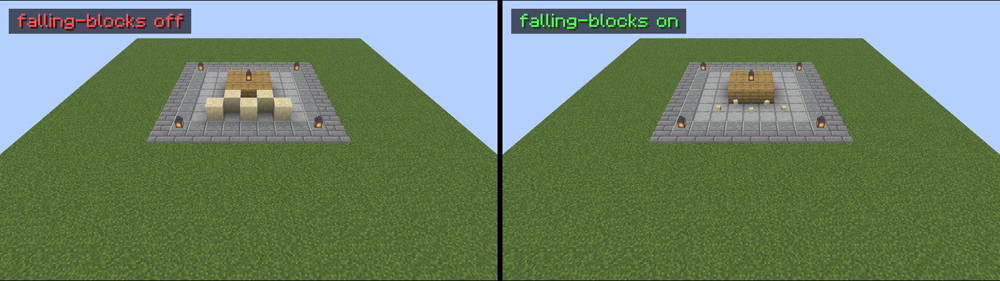
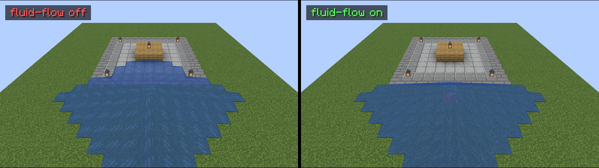
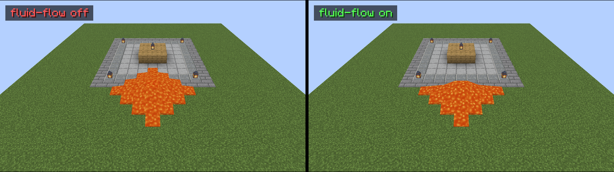
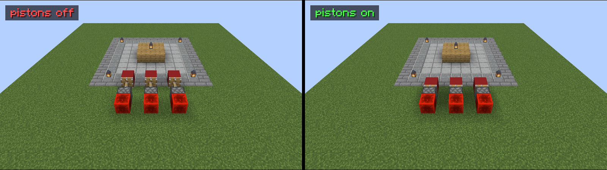
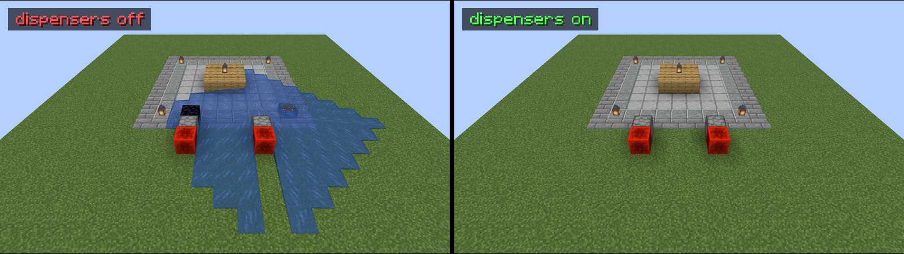
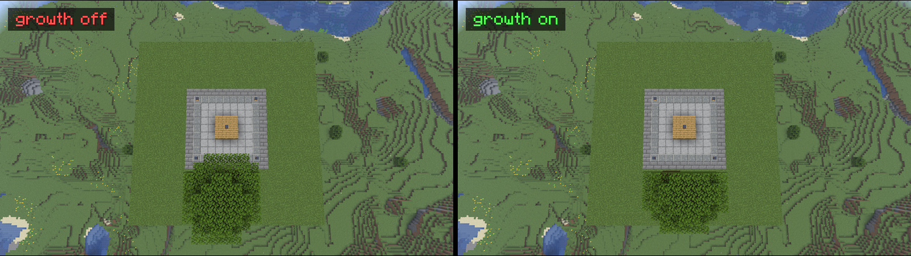

# Protections

Keep your spawn build safe from creepers, TNT, fire and hostile mobs. These protections also cover damage to displays and stop changes reaching in from outside the region. That includes lava, sand, pistons, dispensers, growing trees and dangerous portal arrivals.

Build rights do not bypass these protections, so TNT lit by a trusted builder still cannot destroy protected blocks.

Every protection is on by default and has a switch under `protection:` in `config.yml`. Set a switch to `false` and run `/sbr reload` to turn it off, or leave its key out to use the default.

These protections do not make spawn a safe zone for combat. Players, animals and villagers can still take damage.

| Switch                                        | What it protects                                                                           |
| --------------------------------------------- | ------------------------------------------------------------------------------------------ |
| [`explosions`](#explosions)                   | Blocks inside survive explosions                                                           |
| [`hostile-mob-changes`](#hostile-mob-changes) | Hostile mobs cannot change blocks inside                                                   |
| [`display-damage`](#display-damage)           | Item frames, paintings and armour stands survive environmental damage                      |
| [`fire-damage`](#fire-damage)                 | Blocks inside cannot burn away                                                             |
| [`falling-blocks`](#falling-blocks)           | Falling blocks from outside become items instead of landing inside, when drops are allowed |
| [`fluid-flow`](#fluid-flow)                   | Water and lava flowing from outside stop at the edge                                       |
| [`pistons`](#pistons)                         | Pistons outside cannot move blocks in, out or within the region                            |
| [`dispensers`](#dispensers)                   | Dispensers outside cannot dispense or fire projectiles into the region                     |
| [`growth`](#growth)                           | Trees growing outside cannot place blocks inside                                           |
| [`portal-arrivals`](#portal-arrivals)         | The listed dangerous arrivals are defused before reaching the region                       |

The pictures show a small square region on a grass platform, with the stone floor marking the region at `radius: 5`. Each pair shows the same scene on a Paper 26.3 server running the plugin, once with the switch set to `false` and once with it set to `true`.

## Changes from outside: like a world border

Five protections distinguish between changes that start inside and outside the region. These are `falling-blocks`, `fluid-flow`, `pistons`, `dispensers` and `growth`.

They stop outside sources from reaching into the build while allowing sources inside to work normally. Builders can use sand, water features, piston doors, dispensers and trees at spawn, with other protections still applying. For example, lava placed inside can flow, but `fire-damage` prevents it from lighting nearby blocks.

## `explosions`

**Stops:** any explosion from breaking blocks inside the region. This includes creepers, TNT, TNT minecarts, end crystals, withers, ghast fireballs and wither skulls, as well as beds and respawn anchors exploding in the wrong dimension. Explosions cannot start fires or prime TNT inside, so a TNT chain reaction cannot spread into the region.

**With it off:** a creeper or TNT outside the edge can blast a crater into spawn.

**With it on:** the explosion still happens and can hurt nearby entities. It can break blocks outside, but the crater stops at the region's edge.



**Still works:** a player with build rights can light TNT by hand inside the region, though its explosion still cannot break protected blocks.

## `hostile-mob-changes`

**Stops:** hostile mobs from changing blocks inside the region. Endermen cannot pick up or place blocks, and withers and the ender dragon cannot break them. Silverfish cannot hide in stone or burst out of it, while zombies and vindicators cannot break doors.

Hostile mobs cannot trample farmland or turtle eggs, and their projectiles cannot change blocks they hit. For example, a skeleton's arrow cannot break a decorated pot. The protection also stops mob and projectile ignition, including flaming arrows priming TNT, even when the shooter is a player.

A hostile mob means any mob the game classes as an enemy. This includes zombies, skeletons, creepers, endermen, silverfish, witches, illagers, ghasts, slimes, phantoms, shulkers, hoglins, withers and the ender dragon. It does not include passive and neutral mobs such as villagers, golems, wolves and bees.

**With it off:** an enderman can take a block from your spawn build and put it in a distant field, or a zombie siege can break the doors in your spawn town.

**With it on:** those blocks and doors stay in place.



**Still works:** villagers can farm crops and sheep can eat grass.

## `display-damage`

**Stops:** environmental damage from breaking item frames, glow item frames, paintings and armour stands inside the region. This covers mobs, explosions, fire and projectiles without a player behind them, as well as falling anvils and dripstone.

**With it off:** a skeleton's stray arrow can knock a map out of the welcome board, and a creeper can destroy the armour stands displaying players' first armour.

**With it on:** the frame, painting or stand survives that damage.



**Still works:** players with build rights can break or change displays, and damage attributed to a player's projectile follows the same rule except for explosion damage. Players without build rights cannot change frame contents or armour-stand equipment even with this switch off, as those actions are covered by [build rights](how-it-works.md#what-counts-as-building).

## `fire-damage`

**Stops:** blocks inside the region from burning away and fire from spreading onto them, whether it started inside or outside. Lava and lightning cannot light fires inside, and fire cannot prime protected TNT.

**With it off:** a forest fire can spread across spawn's wooden roofs, or lava in a decorative fountain can light the planks beside it.

**With it on:** the forest fire cannot spread into spawn, and the fountain's lava cannot light the planks.



**Still works:** a player with build rights can light a fire, campfire or nether portal by hand with flint and steel or a fire charge. Fire they light still cannot spread or burn protected blocks.

## `falling-blocks`

**Stops:** falling blocks that started outside the region from landing as blocks inside it. This includes sand, red sand, gravel, concrete powder, anvils and dripstone.

A stopped block drops as an item where it would have landed, as when sand lands on a torch. Normal drop rules still apply, so a destroyed anvil, a block set not to drop an item or a world with entity drops disabled produces no item.

**With it off:** sand knocked off a cliff, pushed by a piston or sent through the End's exit portal can pile up on the spawn floor if no other protection stops it.

**With it on:** the sand lands as items instead of blocks, provided drops are enabled.



**Still works:** blocks that start falling inside the region can land normally, so builders can use their own concrete powder and gravel.

## `fluid-flow`

**Stops:** water and lava from flowing across the edge into the region, and dragon eggs teleporting in from outside.

**With it off:** lava poured outside spawn can flow across the floor.

**With it on:** the flow stops at the edge.





**Still works:** water and lava placed inside by a builder can flow normally, so fountains, moats and lava lamps keep working.

## `pistons`

**Stops:** a piston outside the region from pushing blocks into it, moving or breaking blocks inside it, or extending its head into it. An extension that would do any of these is cancelled.

A sticky piston outside cannot pull a block out of the region. Its head retracts and leaves the block behind, as it would with obsidian.

**With it off:** pistons beside spawn can push blocks into the build or pull blocks out.

**With it on:** pistons trying to push into the region stay retracted, and sticky pistons trying to pull blocks out leave those blocks in place.



**Still works:** pistons inside the region work normally, including those in doors, farms and redstone builds.

## `dispensers`

**Stops:** a dispenser outside from dispensing into the adjacent block if that block is inside the region. This covers water and lava buckets, fire, placed blocks, bone meal and anything else the dispenser can dispense.

Projectiles fired by a dispenser outside are removed as they would enter the region. This includes arrows, fire charges, snowballs, potions and fireworks, even when the dispenser is farther from the edge.

**With it off:** a hidden lava dispenser can flood spawn at the press of a button, or a dispenser turret can fire charges into the build.

**With it on:** a dispenser facing directly into the region dispenses nothing, and projectiles fired towards it from farther away disappear at the edge.



**Still works:** droppers can drop items and dispensers inside the region work normally. Players' and mobs' projectiles can fly through the region, though other protections may stop their effects.

## `growth`

**Stops:** trees, huge mushrooms and bone meal used outside the region from placing blocks inside it. Growth outside still happens, but any blocks that would appear inside are left out.

**With it off:** a dark oak grown against the edge can spread its canopy over the spawn build.

**With it on:** the canopy ends at the region's edge.



**Still works:** saplings inside can grow normally and builders can use bone meal inside the region.

## `portal-arrivals`

Portals preserve an entity's speed. The End's exit portal sends non-player entities to the world spawn, so a wither fought beside it can send skulls straight into spawn and sand dropped through it can pile up there.

This protection removes the listed kinds before they arrive inside the region, without an explosion or damage. Falling blocks become items at the destination, subject to the same drop rules described under `falling-blocks`.

Every portal is covered, and the destination decides whether protection applies wherever the portal itself is.

| Switch           | What it defuses                                                                                                                                               |
| ---------------- | ------------------------------------------------------------------------------------------------------------------------------------------------------------- |
| `explosives`     | Primed TNT and TNT minecarts                                                                                                                                  |
| `wither-skulls`  | Black and blue wither skulls                                                                                                                                  |
| `fireballs`      | Ghast, blaze and dragon fireballs                                                                                                                             |
| `projectiles`    | Plain, spectral and tipped arrows, tridents, llama spit and shulker bullets. Also splash or lingering potions with a harmful effect such as harming or poison |
| `fireworks`      | Firework rockets carrying stars, unless attached to an entity                                                                                                 |
| `falling-blocks` | Sand, gravel and other falling blocks. These arrive as items instead of landing, when drops are allowed                                                       |

**With it off:** a wither skull sent through the End's exit portal can explode in the middle of spawn.

**With it on:** the skull is removed before it arrives.

**Always passes:** players, mobs, items, ender pearls, snowballs, eggs, experience bottles, fishing hooks and wind charges. Plain firework rockets and rockets boosting an elytra also pass, as do helpful potions without harmful effects. Projectiles added by future game versions pass unless they belong to one of the kinds listed above.

Each kind has its own switch, so this example allows everything in the `projectiles` row through while keeping the other listed protections on.

```yaml
protection:
    portal-arrivals:
        explosives: true
        wither-skulls: true
        fireballs: true
        projectiles: false   # allow arrows and the other kinds in the projectiles row
        fireworks: true
        falling-blocks: true
```

Set `portal-arrivals: false` to turn every kind off at once. See [compatibility.md](compatibility.md) for the Folia limitation.

## Checking what is on

Run `/sbr info` as an admin or from the console to see which protections are on and which portal arrivals are defused. These active settings can differ from `config.yml` until you run `/sbr reload`.

```
Protections on: explosions, hostile-mob-changes, display-damage, fire-damage, falling-blocks, fluid-flow, pistons, dispensers, growth
Protections off: none
Portal arrivals defused: explosives, wither-skulls, fireballs, projectiles, fireworks, falling-blocks
Portal arrivals passed: none
```
